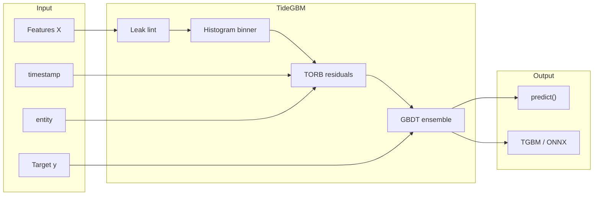

<div align="center">

# TideGBM

**Temporal Ordered Gradient Boosting for panel & market data**

[](https://github.com/Vizanix/TideGBM/actions/workflows/ci.yml)
[](https://pypi.org/project/tidegbm/)
[](https://www.python.org/)
[](LICENSE)

*C++ histogram GBDT · Python sklearn API · TORB time/panel inductive bias*

[Installation](#installation) · [Quick start](#quick-start) · [Benchmarks](#benchmarks) · [Documentation](#documentation) · [Русский](#русский)

</div>

---

## Overview

**TideGBM** is a production-oriented gradient boosting library built for **time-indexed** and **cross-sectional panel** tables — the kind of data you get in quantitative finance, demand forecasting, and multi-entity analytics.

You bring `X` and `y`. TideGBM does **not** compute indicators or alpha factors. Instead, it treats **time order**, **entity structure**, and **purged evaluation** as first-class concerns:

| Capability | What it means |
|---|---|
| **TORB** | Temporal ordered residual boosting — causal leaf residuals and structure that respect the arrow of time |
| **Purge / embargo** | Walk-forward splits with horizon-aware gaps to prevent label leakage |
| **Leak lint** | Strict mode refuses features that peek into the future |
| **Pairwise objective** | Within-date LambdaMART-style ranking for cross-sectional IC |
| **Histogram engine** | Column-major C++17 core with OpenMP; optional CUDA histograms |

This is **not** “better than neural nets.” The target is a **stronger GBDT** for tabular time/panel problems under honest, purged evaluation — not SOTA claims or desk alpha.

---

## Quick start

```python
from tidegbm import TideRegressor

model = TideRegressor(
    horizon=1,
    n_estimators=200,
    max_depth=6,
    objective="pairwise",   # cross-sectional ranking / IC
)
model.fit(X_train, y_train, timestamp="ts", entity="symbol")
pred = model.predict(X_live)
model.save_model("alpha.tgbm")
```

For **level regression** (R², absolute fit), use `objective="mse"` or `objective="auto"`.

---

## Installation

```bash
pip install tidegbm
```

Optional extras: `tidegbm[onnx]`, `tidegbm[bench]`, `tidegbm[dev]`.

**From source** (requires C++17 + OpenMP):

```bash
git clone https://github.com/Vizanix/TideGBM.git
cd TideGBM
python -m venv .venv && source .venv/bin/activate
pip install -e ".[dev]"
pytest
```

| Extra | Purpose |
|---|---|
| `pip install -e ".[onnx]"` | ONNX export (`to_onnx()`) |
| `pip install -e ".[bench]"` | LightGBM + CatBoost benchmarks |
| `TIDEGBM_CUDA=1 bash scripts/build_gpu_wheel.sh` | GPU histogram wheel (needs `nvcc`) |

Default wheels are **CPU-only**; `device="gpu"` raises unless built with CUDA.

---

## Benchmarks

Public stand: **30 liquid names** (Yahoo daily bars), purged expanding walk-forward, labels **demeaned within date** for IC alignment.

```bash
pip install -e ".[bench]"
python benchmarks/markets.py --horizons 1,3,5,10
```

**Snapshot (2026-08-25)** — 80 trees, depth 6, lr 0.08, 3 folds:

| Model | h=1 | h=3 | h=5 | h=10 | **Mean IC** |
|---|---:|---:|---:|---:|---:|
| **TideGBM pairwise** | **0.026** | **0.020** | **0.050** | 0.027 | **0.031** |
| TideGBM MSE | 0.026 | 0.016 | 0.026 | **0.039** | 0.027 |
| LightGBM 4.7 | 0.023 | 0.008 | 0.024 | 0.024 | 0.019 |
| CatBoost 1.2 | 0.021 | 0.005 | 0.024 | 0.025 | 0.019 |

Tide pairwise beats LightGBM on **all four horizons** on this protocol. LightGBM remains **~5–10× faster** to fit. Three folds, noisy IC — interpret as a sanity check, not a profit guarantee.

Full protocol: [`docs/TIDEBENCH.md`](docs/TIDEBENCH.md)

---

## Architecture



---

## Production defaults

- `timestamp` required (unless `iid_mode=True`); `horizon` required in time mode
- `lint_mode="strict"` — refuses lookahead features
- `eval_metric="auto"` — cross-sectional IC when time or rank mode is on
- `max_bin=255`; full-train split structure (`causal_structure=False`)
- `n_time_buckets=0` — auto 32/64 buckets from label horizon
- `goss=None` — auto GOSS at ≥250k rows
- Eval set must be **strictly in the future**

---

## Documentation

| Document | Contents |
|---|---|
| [**`docs/API.md`**](docs/API.md) | **Python API reference** (estimators, fit params, CV, lint) |
| [`examples/quant_walkthrough.ipynb`](examples/quant_walkthrough.ipynb) | Jupyter walk-through for quants |
| [`docs/DESIGN.md`](docs/DESIGN.md) | Algorithm design & TORB RFC |
| [`docs/TIDEBENCH.md`](docs/TIDEBENCH.md) | Benchmark protocol & quality search |
| [`docs/LEAKAGE.md`](docs/LEAKAGE.md) | Leakage anti-patterns |
| [`docs/COMPATIBILITY.md`](docs/COMPATIBILITY.md) | Semver & model format |
| [`CHANGELOG.md`](CHANGELOG.md) | Release history |

---

## Project layout

```
cpp/                  C++ core, C API, optional CUDA histograms
src/tidegbm/          Python sklearn wrappers
benchmarks/           markets.py, tidebench.py, bench_scale.py
tests/                pytest suite (39 tests)
.github/workflows/    CI, wheel builds, GPU wheel pipeline
```

---

## License

Apache-2.0 — see [`LICENSE`](LICENSE).

---

<br>

## Русский

<div align="center">

### TideGBM — градиентный бустинг для временных панелей и рынков

</div>

**TideGBM** — библиотека градиентного бустинга на **C++** с Python-обёрткой в стиле sklearn. Создана для таблиц с **временной структурой** и **поперечным сечением** (много инструментов / сущностей на одну дату): количественные финансы, спрос, мульти-объектная аналитика.

Вы приносите `X` и `y`. Библиотека **не строит индикаторы** — она учитывает **порядок времени**, **структуру панели** и **честную purged-оценку** как часть алгоритма.

#### Ключевые возможности

| | |
|---|---|
| **TORB** | Временно-упорядоченные остатки — каузальная структура сплитов и листьев |
| **Purge / embargo** | Walk-forward с зазором по горизонту — защита от утечки меток |
| **Leak lint** | Строгий режим отклоняет признаки с lookahead |
| **`objective="pairwise"`** | Ранжирование внутри даты для cross-sectional IC |
| **Движок** | Гистограммы column-major, OpenMP; опционально CUDA |

#### Быстрый старт

```python
from tidegbm import TideRegressor

model = TideRegressor(horizon=1, n_estimators=200, max_depth=6, objective="pairwise")
model.fit(X, y, timestamp="ts", entity="symbol")
pred = model.predict(X_live)
```

Для **уровневой регрессии** (R², абсолютная ошибка) — `objective="mse"`.

#### Установка

```bash
pip install tidegbm
```

Из исходников:

```bash
git clone https://github.com/Vizanix/TideGBM.git && cd TideGBM
python -m venv .venv && source .venv/bin/activate
pip install -e ".[dev]" && pytest
```

Полная документация API: [`docs/API.md`](docs/API.md).

#### Бенчмарк (30 публичных тикеров, Yahoo)

Purged walk-forward, метки **центрированы по дате**. Лучший рецепт: depth 6, `objective="pairwise"`.

| Модель | h=1 | h=3 | h=5 | h=10 | **Ср. IC** |
|---|---:|---:|---:|---:|---:|
| **TideGBM pairwise** | **0.026** | **0.020** | **0.050** | 0.027 | **0.031** |
| LightGBM | 0.023 | 0.008 | 0.024 | 0.024 | 0.019 |

Tide pairwise обходит LightGBM на **всех четырёх горизонтах** в этом протоколе. LightGBM по-прежнему **в 5–10 раз быстреe** на fit. IC ~0.03 — слабый сигнал; это не гарантия прибыли.

Подробности: [`docs/TIDEBENCH.md`](docs/TIDEBENCH.md) (на английском).

#### Документация

| Файл | О чём |
|---|---|
| [`docs/DESIGN.md`](docs/DESIGN.md) | Алгоритм и TORB |
| [`docs/LEAKAGE.md`](docs/LEAKAGE.md) | Анти-паттерны утечек |
| [`CHANGELOG.md`](CHANGELOG.md) | История версий |

#### Оговорки

- Не заявляем SOTA и «альфу деска».
- SHAP-значения — Saabas path attributions (аддитивные), не Independent TreeSHAP.
- `objective="auto"` остаётся MSE для совместимости с регрессионными тестами; pairwise — для ранжирования / IC.

Лицензия: **Apache-2.0**.

---

<div align="center">

<br>

---

**Built by [Vizanix](https://github.com/Vizanix)** — algorithmic trading systems, signal pipelines & automated software for crypto markets.

Explore our work at **[vizanix.tech](https://vizanix.tech)** · Questions & contributions welcome via [Issues](https://github.com/Vizanix/TideGBM/issues).

</div>
